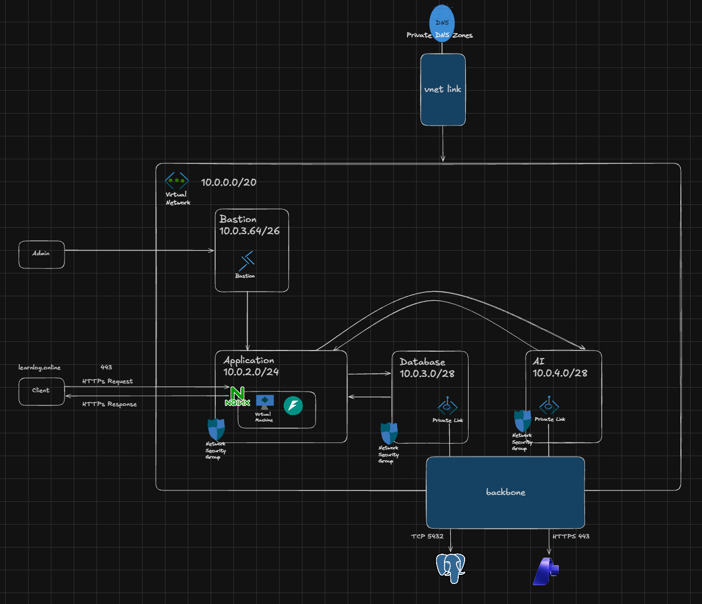
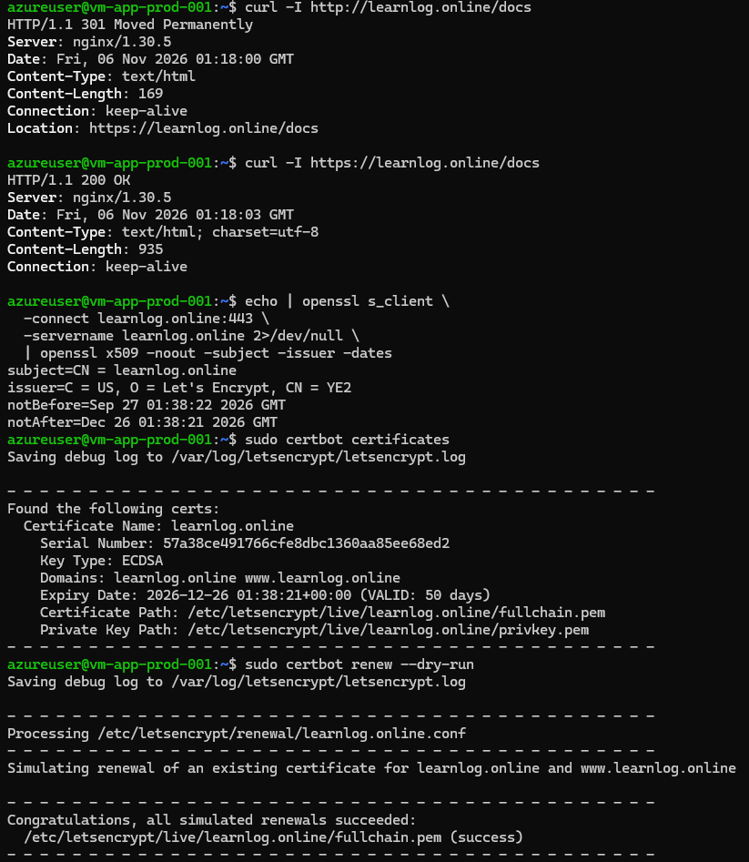
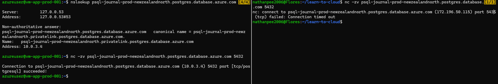
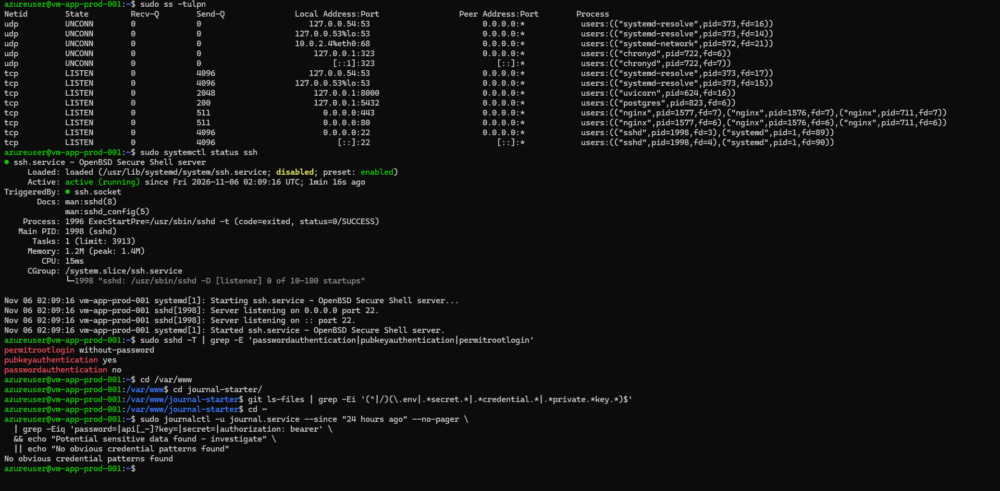
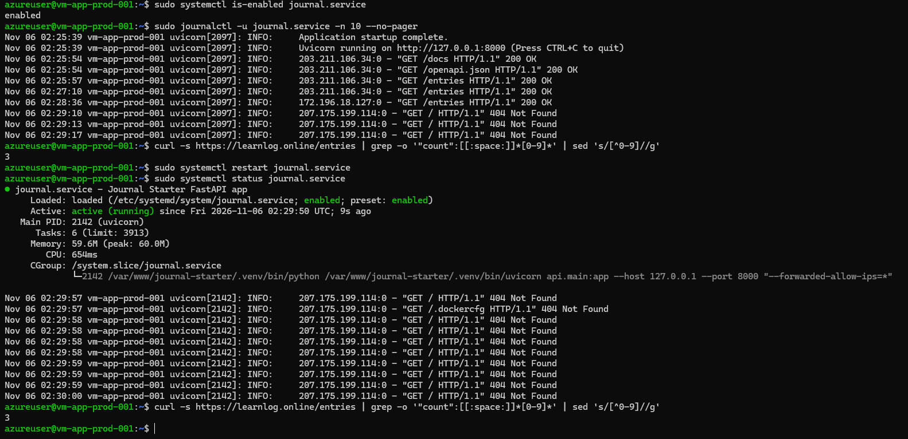
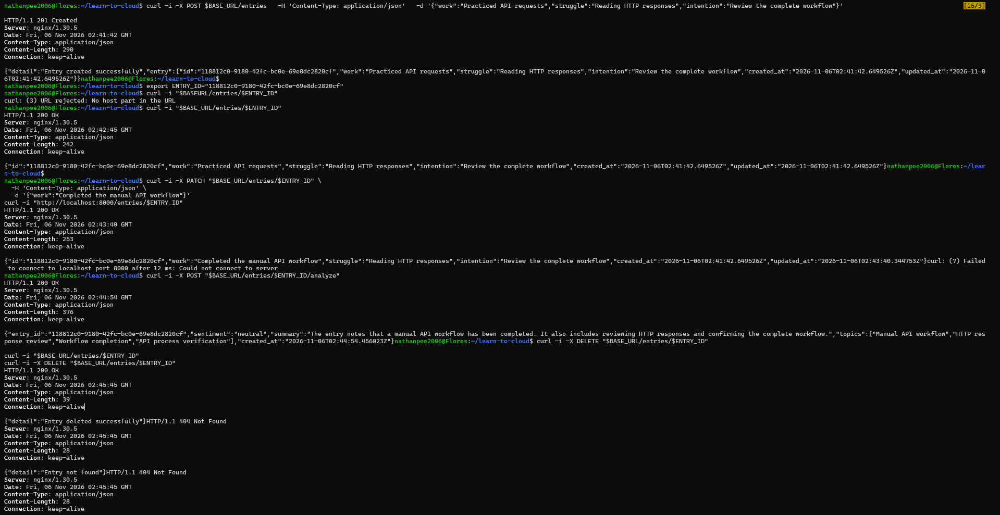

# Journal API – Azure Cloud Deployment

> **Cloud Provider:** Microsoft Azure  
> **Status:** Completed  
> **Deployment URL:** https://learnlog.online

---

## 1. Project Overview

The Journal API is a cloud-hosted application deployed on Microsoft Azure.

The objective of this project is to demonstrate practical cloud deployment and security concepts, including:

- Azure Virtual Machines
- Virtual Networks and subnet segmentation
- Network Security Groups (NSGs)
- Nginx reverse proxy
- HTTPS and SSL/TLS certificates using Let's Encrypt
- PostgreSQL database connectivity through Azure Private Endpoint
- Microsoft Foundry integration through Private Endpoint
- Azure cost management and budgeting

### Project Objectives

1. Expose the API over public HTTPS with a trusted certificate.
2. Keep PostgreSQL on a separate private tier that accepts connections from the application tier but not the public internet.
3. Keep management ports private, require authenticated administrative access, and keep credentials out of source control and logs.
4. Keep the service running after your administrative session ends and preserve journal data across application restarts.
5. Preserve the completed Journal API behavior, including CRUD operations and analysis through a live AI service.
6. Estimate costs and configure budget alerts before provisioning.

---

## 2. Architecture

### Architecture Diagram



### Architecture Components

| Component | Purpose |
|---|---|
| Azure Virtual Network | Provides private network connectivity |
| Application Subnet | Hosts the application VM |
| Azure VM | Runs the application and Nginx |
| Nginx | Reverse proxy and HTTPS termination |
| PostgreSQL Private Endpoint | Private connectivity to the database |
| Database Subnet | Hosts the PostgreSQL private endpoint NIC |
| Foundry Private Endpoint | Private connectivity to Microsoft Foundry |
| Foundry Subnet | Hosts the Foundry private endpoint NIC |
| NSGs | Control inbound and outbound network traffic |
| Azure Private DNS | Resolves private endpoint hostnames |

---

## 3. Azure Infrastructure

### Resource Inventory

| Resource | Name | Configuration |
|---|---|---|
| Resource Group | rg-journalAPI-prod-newzealandnorth | New Zealand North |
| Virtual Network | vnet-journalAPI-prod-newzealandnorth-001 | 10.0.0.0/20 |
| Application Subnet | snet-app-prod-newzealandnorth | 10.0.2.0/24 |
| Database PE Subnet | snet-db-prod-newzealandnorth | 10.0.3.0/28 |
| Foundry PE Subnet | snet-ai-newzealandnorth | 10.0.4.0/28 |
| Virtual Machine | vm-app-prod-001 | Standard D2als v6 (2 vcpus, 4 GiB memory)/Ubuntu |
| PostgreSQL Server | psql-journal-prod-newzealandnorth | Burstable, B1ms, 1 vCores, 2 GiB RAM, 32 GiB storage |
| PostgreSQL Private Endpoint | pep-dbsql-sql-prod-newzelandnorth | 10.0.3.4 |
| Foundry Private Endpoint | pep-mfdry-prod-newzealandnorth-account | 10.0.4.4 |

### Private DNS Zones

| Private DNS Zone |
|---|
| privatelink.cognitiveservices.azure.com |
| privatelink.openai.azure.com |
| privatelink.postgres.database.azure.com |
| privatelink.services.ai.azure.com |

### Network Security Groups (NSGs)

| Subnet | NSG Name |
|---|---|
| snet-ai-newzealandnorth | nsg-ai-prod-newzealandnorth-001 |
| snet-app-prod-newzealandnorth | nsg-app-prod-newzealandnorth-001 |
| snet-db-prod-newzealandnorth | nsg-db-prod-newzealandnorth-001 |

### Network Addressing

| Subnet | Address Range | Purpose |
|---|---|---|
| Application | 10.0.2.0/24 | Application VM |
| Database PE | 10.0.3.0/28 | PostgreSQL private endpoint |
| Foundry PE | 10.0.4.0/28 | Foundry private endpoint |

---

## 4. Network Security

### Network Security Groups

NSGs are used to enforce network segmentation and restrict access between application components.

#### Application Subnet

| Priority | Direction | Source | Destination | Port | Protocol | Action |
|---:|---|---|---|---|---|---|
| 100 | Inbound | Internet | Application VM (10.0.2.4) | 443 | TCP | Allow |
| 110 | Inbound | Internet | Application VM (10.0.2.4) | 80 | TCP | Allow |
| 120 | Inbound | Bastion Subnet (10.0.3.64/26) | Application VM (10.0.2.0/24) | 22 | TCP | Allow |

#### Database Private Endpoint Subnet

| Priority | Direction | Source | Destination | Port | Protocol | Action |
|---:|---|---|---|---|---|---|
| 100 | Inbound | Application Subnet (10.0.2.0/24) | Database Subnet (10.0.3.0/28) | 5432 | TCP | Allow |

#### Foundry Private Endpoint Subnet

| Priority | Direction | Source | Destination | Port | Protocol | Action |
|---:|---|---|---|---|---|---|
| 100 | Inbound | Application Subnet (10.0.2.0/24) | AI Foundry Subnet (10.0.4.0/28) | 443 | TCP | Allow |

### Private Endpoint Network Policies

Private endpoint network policies were configured to allow NSG enforcement on the private endpoint subnets.

| Subnet | NSG Policy Enabled | 
|---|---|
| Database PE Subnet | Yes |
| Foundry PE Subnet | Yes |

---

## 5. Nginx and HTTPS Configuration

Nginx acts as the reverse proxy for the application.

### Request Flow

1. User accesses `https://learnlog.online`.
2. Nginx receives the HTTPS request on port 443.
3. Nginx terminates TLS.
4. Nginx forwards the request to the application on `127.0.0.1:8000`.
5. The application processes the request and returns a response.

### Nginx Configuration

Configuration file:

`/etc/nginx/conf.d/[custom-config].conf`

```nginx
server {
    listen 443 ssl;
    server_name learnlog.online www.learnlog.online;

    ssl_certificate /etc/letsencrypt/live/learnlog.online/fullchain.pem;
    ssl_certificate_key /etc/letsencrypt/live/learnlog.online/privkey.pem;

    location / {
        proxy_pass http://127.0.0.1:8000;
        proxy_set_header Host $host;
        proxy_set_header X-Real-IP $remote_addr;
        proxy_set_header X-Forwarded-For $proxy_add_x_forwarded_for;
        proxy_set_header X-Forwarded-Proto $scheme;
    }
}
```

### HTTPS Verification

- [ ] Domain resolves to the VM's public IP.
- [ ] HTTP redirects to HTTPS.
- [ ] HTTPS certificate is valid.
- [ ] Certificate covers the required domain names.
- [ ] Nginx configuration passes `nginx -t`.
- [ ] Application is accessible through the HTTPS endpoint.

### Certificate Renewal

Certificate provider: Let's Encrypt / Certbot.

Verification commands:

```bash
sudo certbot certificates
sudo certbot renew --dry-run
systemctl list-timers --all | grep -i certbot
```

**Renewal mechanism:** systemd timer 

---

## 6. Database Security and Private Connectivity

### Database Configuration

| Setting | Value |
|---|---|
| Database service | Azure Database for PostgreSQL |
| Server name | psql-journal-prod-newzealandnorth |
| Database name | postgres |
| Port | 5432 |
| Private Endpoint | pep-dbsql-sql-prod-newzelandnorth |
| Private IP | 10.0.3.4 |
| Private DNS Zone | privatelink.postgres.database.azure.com |
| Public Access | Disabled |

### DNS Verification

Command:

```bash
nslookup YOUR_DATABASE_HOSTNAME
```

Expected result: the database hostname resolves to the private endpoint IP.

**Actual result:** [Document result]

### Connectivity Verification

Command:

```bash
nc -zv YOUR_DATABASE_HOSTNAME 5432
```

Expected result: successful TCP connection.

PostgreSQL authentication test:

```bash
psql "host=YOUR_DATABASE_HOSTNAME port=5432 dbname=YOUR_DATABASE_NAME user=YOUR_DATABASE_USER sslmode=require"
```

Test query:

```sql
SELECT
    current_database(),
    current_user,
    inet_server_addr(),
    inet_server_port();
```

---

## 7. Microsoft Foundry Integration

Microsoft Foundry is integrated to provide AI-powered application functionality.

### Network Configuration

| Setting | Value |
|---|---|
| Service | Microsoft Foundry |
| Private Endpoint | pep-mfdry-prod-newzealandnorth-account |
| Private IP | 10.0.4.4 |
| Application Subnet | snet-ai-newzealandnorth |
| Endpoint Port | TCP 443 |

### AI Model and Configuration

| Setting | Configuration |
|---|---|
| Model Provider | Azure OpenAI |
| Model Name | `gpt-5.4-nano` |
| Endpoint Connectivity | Private Endpoint |
| Private DNS Zone | `privatelink.openai.azure.com` |
| Authentication | API Key |
| Application Integration | Backend application connects to the model endpoint |

### AI Safety Controls

The following controls help reduce the risk of unsafe, inappropriate, or unintended AI-generated responses.

| Safety Control | Purpose | Implementation |
|---|---|---|
| Content Filtering | Detect and filter harmful or inappropriate prompts and responses | Microsoft.DefaultV2 Guardrail |
| Output Validation | Check model responses before displaying them to users | Backend application |
| Authorization | Prevent unauthorised access to the AI endpoint | API Key |
| Network Isolation | Restrict access to the AI service through private connectivity | Azure Private Endpoint and Private DNS |

### Connectivity Verification

DNS lookup:

```bash
nslookup YOUR_FOUNDRY_HOSTNAME
```

TCP connectivity:

```bash
nc -zv YOUR_FOUNDRY_HOSTNAME 443
```

HTTPS test:

```bash
curl -I https://YOUR_FOUNDRY_HOSTNAME
```

A `401` or `403` response can indicate that network connectivity works, but authentication is required.

---

## 8. Application Deployment

### Application Details

| Setting | Value |
|---|---|
| Application Name | LearnLog |
| Runtime | Python |
| Framework | FastAPI |
| Application Port | 8000 |
| Deployment Location | Azure VM |
| Process Manager | systemd |
| Reverse Proxy | Nginx |

### Deployment Process

1. Provision Azure infrastructure.
2. Configure VNet and subnets.
3. Configure NSGs.
4. Deploy application VM.
5. Install application dependencies.
6. Configure PostgreSQL connectivity.
7. Configure Microsoft Foundry connectivity.
8. Configure Nginx.
9. Configure HTTPS using Certbot.
10. Verify application functionality.

---

## 9. Cost Management

Azure Cost Management and the Azure Pricing Calculator were used to estimate and monitor infrastructure expenses. Estimated costs are under the assumption that some resources are used for 730 hours.

### Cost Estimation

| Resource | Estimated Monthly Cost |
|---|---:|
| Virtual Machine | $131.18 |
| Managed Disks | $9.39 |
| PostgreSQL | $36.75 |
| Private Endpoints | $26.01 |
| Public IP | $6.49 |
| DNS | $3.56 |
| **Estimated Total** | **$213.38** |

Currency: [NZD]

### Budget Configuration

| Setting | Value |
|---|---|
| Monthly Budget | $50 |
| 50% Threshold | $25 |
| 80% Threshold | $40 |
| 100% Threshold | $50 |

**Note:** Azure budgets generate notifications; they do not automatically stop resources. Furthermore, the above total is only an estimate in reality its costs around $50-60 NZD per month.

### Cost Optimization Decisions

- NAT Gateway removed to reduce recurring costs.
- De-allocate VMs to reduce cost when not in use.
- Delete Bastion and its public IP after use.

---

## 10. Security Considerations and Limitations

### Implemented Security Controls

- HTTPS encryption using TLS.
- Nginx reverse proxy.
- NSG-based network segmentation.
- Restricted SSH access.
- PostgreSQL private connectivity.
- Microsoft Foundry private connectivity.
- Private DNS resolution.

### Known Limitations

- Application authentication not implemented.
- No frontend UI.

---

## 11. Evidence and Screenshots

This section documents the evidence collected to verify that the deployment satisfies the six deployment constraints. Screenshots are organized by requirement and demonstrate both Azure configuration and successful application behavior.

### Expose the API over public HTTPS with a trusted certificate. 



- HTTP redirects to HTTPs
- HTTPs response status code 200
- Certificate configured

### Keep PostgreSQL on a separate private tier that accepts connections from the application tier but not the public internet. 



- DB hostname resolves to private IP
- App can reach DB via TCP 5432
- Internet cannot access private DB

### Keep management ports private, require authenticated administrative access, and keep credentials out of source control and logs. 



- SSH exposed at port TCP 22 (only Bastion can access the VM via NSG rules)
- SSH public key authentication required
- Credentials not tracked by git
- Application logs do not show sensitive credentials.

### Keep the service running after administrative session ends and preserve journal data across application restarts. 



- Application runs on start.
- The journal entry count remains unchanged after the application restart.
- Application continues running even if the Bastion session ends.
```
curl -I https://learnlog.online/docs

HTTP/1.1 200 OK
Server: nginx/1.30.5
Date: Fri, 06 Nov 2026 02:34:46 GMT
Content-Type: text/html; charset=utf-8
Content-Length: 935
Connection: keep-alive
```

### Preserve the completed Journal API behavior, including CRUD operations and analysis through a live AI service. 



- CRUD and AI analysis return successful status codes

### Estimate costs and configure budget alerts before provisioning. 

**Estimated monthly infrastructure cost:**

| Resource | Estimated Monthly Cost |
|---|---:|
| Virtual Machine | $131.18 |
| Managed Disks | $9.39 |
| PostgreSQL | $36.75 |
| Private Endpoints | $26.01 |
| Public IP | $6.49 |
| DNS | $3.56 |
| **Estimated Total** | **$213.38** |

Budget alert thresholds:

- 50% of monthly budget
- 80% of monthly budget
- 100% of monthly budget

The evidence collection provides a record of deployment validation and demonstrates whether each of the six deployment constraints has been satisfied.


